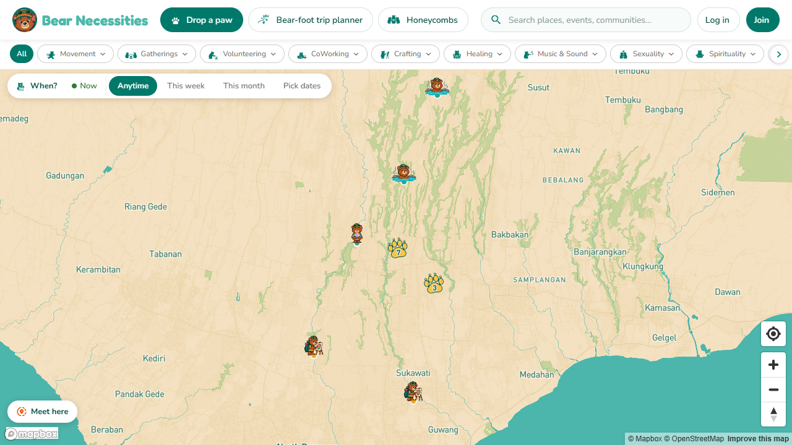
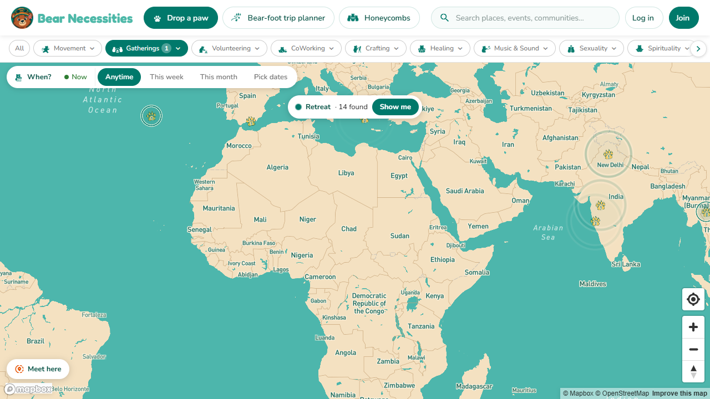
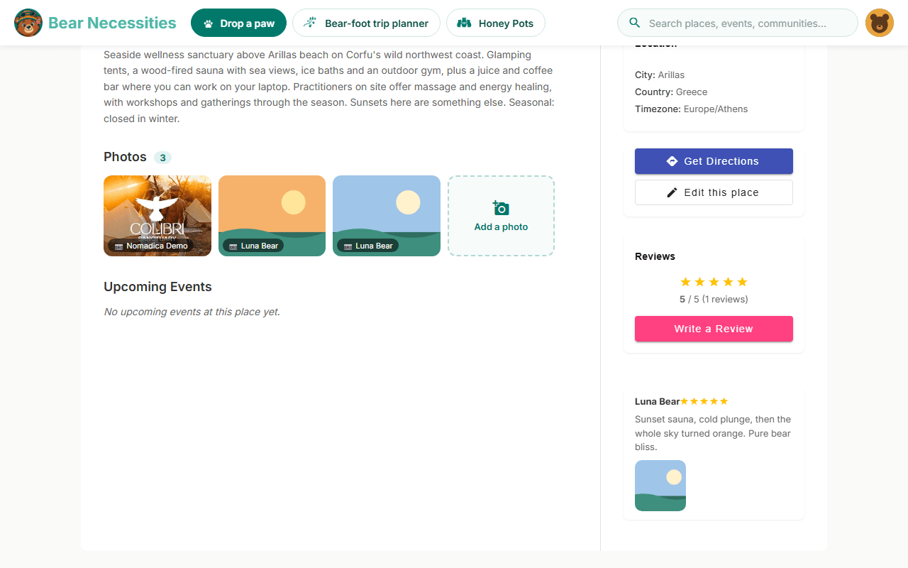
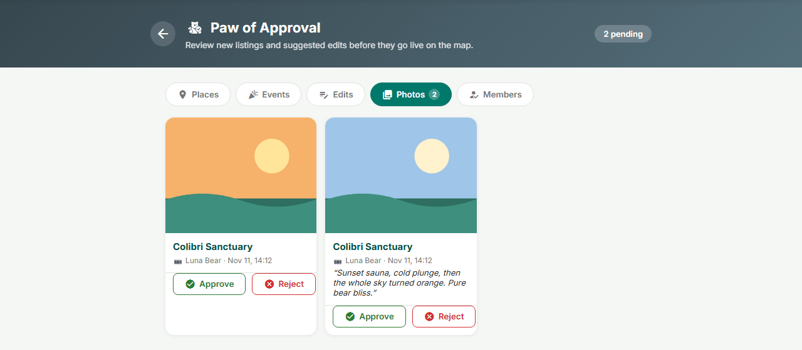
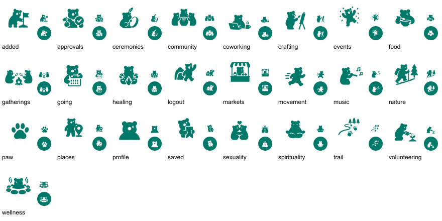

<p align="center"></p>

# 🐻 Bear Necessities

**A map for conscious travelers.** Ecstatic dance, tantra, sound healing, vipassana, retreats, eco-villages,
cacao ceremonies, hippie markets and festival grounds — wherever you land, find the places and gatherings
that speak to you.



## What it does

- **One map for places and happenings.** Seeded with a hand-checked example of each kind of place in Portugal,
  Spain, Greece, India, Indonesia, Thailand, Mexico and Costa Rica (from OpenStreetMap and research); the rest
  comes from the community.
  A venue with something coming up wears a gold ring and the date; its page says what's next.
- **"When?" filter.** Anytime, this week, this month or picked dates: with dates chosen the map keeps what's
  always open plus what's happening then, so festival grounds only appear while a festival is on.
- **14 categories, 80+ subcategories**, each drawn as a bear (Movement, Healing, Music & Sound,
  Ceremonies…). Filtered matches pulse on the map, and a chip counts them worldwide with a jump to them.

  

- **Community-built and moderated.** Anyone can add a place or event ("Drop a paw"), suggest an edit,
  share photos or attach them to a review. Everything from members waits in **Paw of Approval** — new
  listings, suggested edits (shown field by field, now vs. suggested), photos and new members — while
  admins' own changes go live straight away.

  
  

- **Photos with credit.** Places without their own photos get a freely licensed one from Wikimedia
  Commons, matched by location and name, with the photographer credited.
- **Bear-foot trip planner** groups what's around a destination into a few days of stops.
- **Profiles** with a photo (or a bear on honey yellow until there is one), saved places
  (want to go / been there / loved it), RSVPs and the listings you've added.



## Tech stack

| Layer | Built with |
|---|---|
| API | .NET 8, ASP.NET Core, EF Core 8, SQL Server, Serilog |
| Architecture | Clean Architecture (Domain → Application → Infrastructure → API), one handler per use case, value-object IDs, Unit of Work |
| Web | Angular 22, signals, Mapbox GL JS v3 |
| Storage | Cloudflare R2 (S3-compatible) with presigned uploads |
| Data | OpenStreetMap via the Overpass API, Wikimedia Commons for photos |
| Tests | xUnit, Moq, FluentAssertions (167 tests), Vitest |

```
BearNecessities/            .NET solution
  BearNecessities.Domain          entities, value objects, repository interfaces
  BearNecessities.Application     use-case handlers, DTOs
  BearNecessities.Infrastructure  EF Core, repositories, OSM import, photo matching, storage
  BearNecessities.API             controllers, auth, command-line import tools
  BearNecessities.Application.Tests
bear-necessities-web/       Angular app
  design/                         scripts that generate the bear icons and paw markers
```

## Running it locally

You need the .NET 8 SDK, Node.js 20+ and SQL Server (a Docker container works well).

**1. Secrets** — kept in `dotnet user-secrets`, never in `appsettings*.json`:

```bash
cd BearNecessities/BearNecessities.API
dotnet user-secrets set "ConnectionStrings:DefaultConnection" "Server=localhost,1433;Database=BearNecessities;User Id=sa;Password=<your password>;TrustServerCertificate=True"
dotnet user-secrets set "JwtSettings:SecretKey" "<a long random string>"
dotnet user-secrets set "Storage:AccountId" "<Cloudflare account id>"
dotnet user-secrets set "Storage:AccessKey" "<R2 access key>"
dotnet user-secrets set "Storage:SecretKey" "<R2 secret key>"
```

**2. API** (applies migrations and seeds demo data on start):

```bash
dotnet run --project BearNecessities/BearNecessities.API --launch-profile http
```

**3. Web app** (then open http://localhost:4200):

```bash
npm --prefix bear-necessities-web install
npm --prefix bear-necessities-web start
```

**Importing places** from OpenStreetMap, and finding photos for them:

```bash
dotnet run --project BearNecessities/BearNecessities.API -- import-osm --iso PT --country Portugal
dotnet run --project BearNecessities/BearNecessities.API -- import-osm --iso ES --country Spain --by-region
dotnet run --project BearNecessities/BearNecessities.API -- find-photos --country PT
```

**Tests:**

```bash
dotnet test BearNecessities/BearNecessities.sln
npm --prefix bear-necessities-web test -- --watch=false
```

## Credits

Map data © [OpenStreetMap](https://www.openstreetmap.org/copyright) contributors. Place photos from
[Wikimedia Commons](https://commons.wikimedia.org), credited on each photo under their CC licences.
Maps by [Mapbox](https://www.mapbox.com).

© Elad. All rights reserved.
